<div align="center">

<h1>▦ taskboard</h1>

<p><b>A real-time Kanban board where every card can get its own AI browser agent.</b><br>
Watch the agents work live, take over with one click, and keep the whole team in sync.</p>

<p>
<a href="https://github.com/isaaclins/taskboard/actions/workflows/ci.yml"></a>
<a href="LICENSE"></a>


<a href="CONTRIBUTING.md"></a>
</p>

<p>
<a href="#quick-start">Quick start</a> ·
<a href="docs/architecture.md">How it works</a> ·
<a href="docs/api.md">API</a> ·
<a href="docs/configuration.md">Configuration</a>
</p>

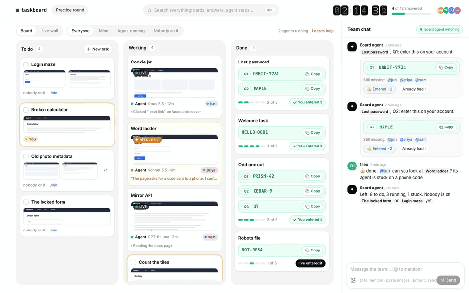

</div>

## Why

Some work comes as a pile of small tasks that a team has to get through together, against the clock: a hackathon,
a puzzle hunt, a QA bash, a research sprint. AI browser agents are good at a lot of these tasks, but running ten of
them in ten windows while five people shout over each other is chaos.

Taskboard puts all of it on one board. Every task is a card. Anyone can start an agent on a card, and everyone can
see what it is doing, live, in a real browser. When an agent gets stuck on a login code or a captcha, its card turns
amber and a person can take over the browser right from the board. Answers land on the card the moment the agent
finds them, and the team chat tells everyone who still has to enter them.

## Features

<table>
<tr>
<td width="50%">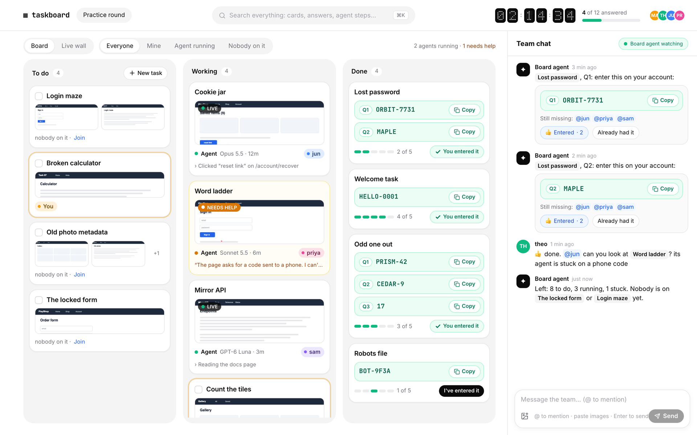</td>
<td width="50%">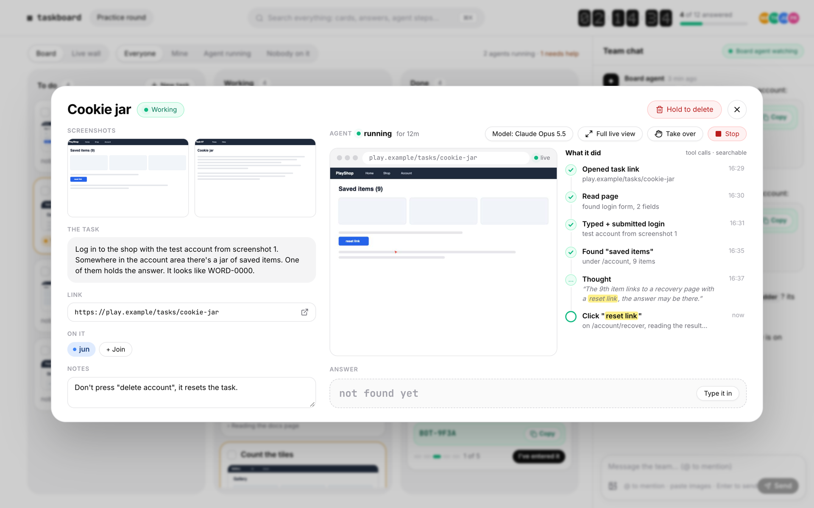</td>
</tr>
<tr>
<td><b>A board that updates for everyone, instantly.</b> To do, Working, Done. Drag cards around, filter by
<i>mine</i>, <i>agent running</i> or <i>nobody on it</i>. Your cards carry a soft ring in your colour.</td>
<td><b>Every card knows everything about its task.</b> Screenshots, the task as read from them, the link, notes,
who is on it, every step the agent took, and any number of answers (Q1, Q2, ...).</td>
</tr>
<tr>
<td>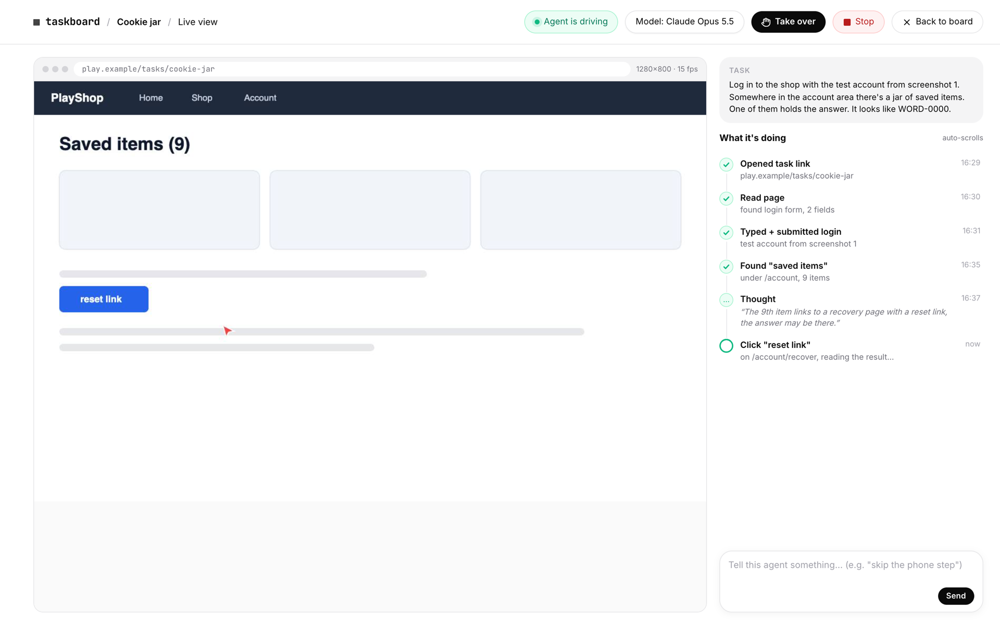</td>
<td>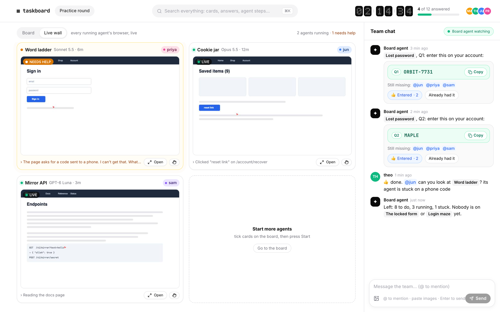</td>
</tr>
<tr>
<td><b>Live view with take over.</b> The agent's browser tab streams to the board as real video (around 15 to 20
frames a second). Press <i>Take over</i> and your clicks and keys go straight into that tab while the agent waits.
Hand it back with a note.</td>
<td><b>The live wall.</b> Every running agent on one screen. Tiles that need a person turn amber and say what the
agent is asking.</td>
</tr>
<tr>
<td>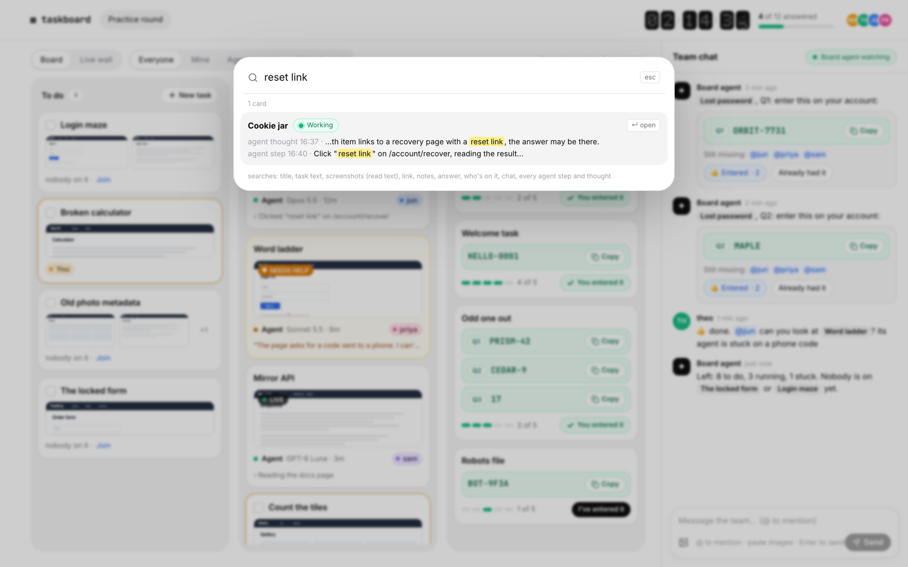</td>
<td>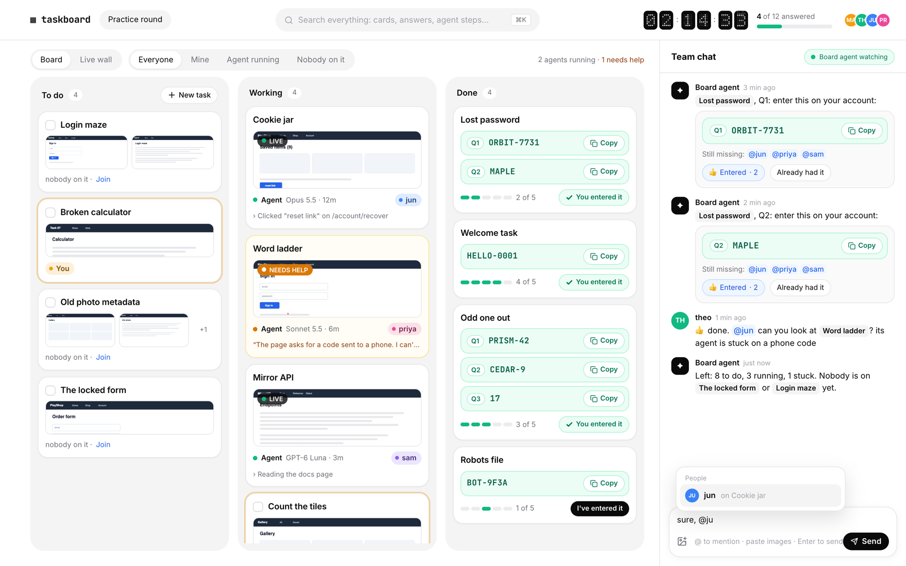</td>
</tr>
<tr>
<td><b>Search everything (⌘K).</b> Titles, task text, text read from screenshots, links, notes, answers, people,
chat, and every single agent step and thought, including the page text the agent saw.</td>
<td><b>Team chat with a board agent.</b> <code>@mentions</code>, images and reactions. The board agent announces
answers as they land, nudges whoever has not entered them yet, and answers <code>@board</code> questions.</td>
</tr>
</table>

And also:

- **Cards from screenshots.** The owner pastes screenshots of a task anywhere on the board (or uses *New task*) and
  Claude reads them into a title, task text and link. Scripts can do the same with [`bin/card`](bin/card) and the
  [API](docs/api.md).
- **Pick a model per card**, or tick a batch of cards and start an agent on each of them at once.
- **Agents that keep going.** A watchdog notices stalled sessions, nudges agents that stop early, and the server
  re-attaches to running agents after a restart.
- **Screen mode** for pages that are pictures rather than HTML (canvas apps, remote desktops such as noVNC): the
  agent looks at screenshots and clicks by coordinates.
- **"I've entered it" tracking.** Each answer shows who has entered it already (2 of 5), so nobody is left behind.
- **A timer** with airport-board digits, and progress across the whole board.
- **Works on a phone**, with a layout made for it.

<p align="center">
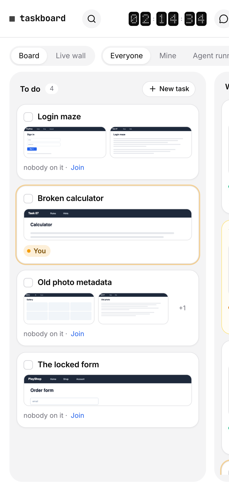&nbsp;
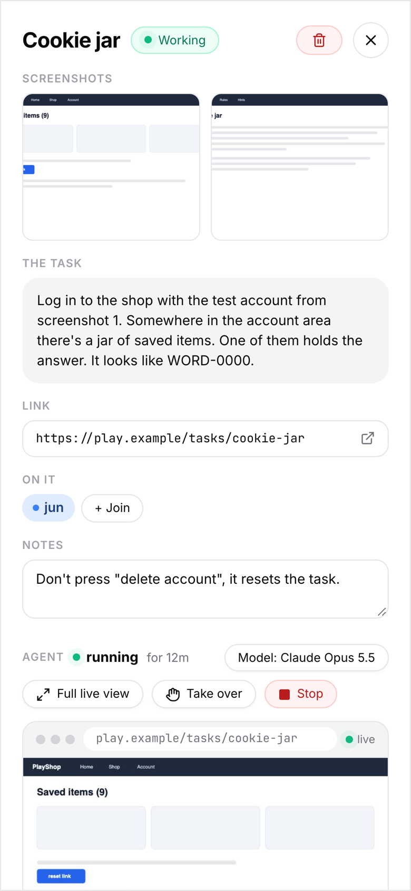&nbsp;
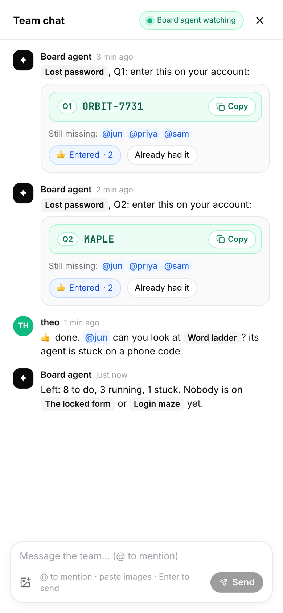
</p>

## Quick start

### See it in 30 seconds (no setup, no agents)

The web app has a built-in simulated backend with a team, cards, agents and a live view, so you can click
through everything locally before setting anything up.

```sh
git clone https://github.com/isaaclins/taskboard && cd taskboard/web
npm install
npm run mock        # open http://localhost:5180
```

### Run a real board

You need [Bun](https://bun.sh) 1.2+ and Node.js 20+ (to build the web app).

```sh
git clone https://github.com/isaaclins/taskboard && cd taskboard
bun install
npm run build                     # builds web/ into web/dist
cp .env.example .env              # set your team and a passcode
bun start                         # http://127.0.0.1:8823
```

Open the board, pick your name, enter the passcode. The board, chat, answers and search work right away.

### Add the agents

Card agents run in [Aside](https://aside.com), an AI browser for macOS and Windows with a free plan. Taskboard
drives it through the Aside CLI: one agent session and one browser tab per card.

1. Install Aside, open it once, and sign in.
2. Sign the CLI in: `aside login` (confirm the code in Aside under Settings, Account, Devices).
3. Connect the AI subscriptions you want the agents to use inside Aside (for example Claude or ChatGPT).
4. Restart Taskboard. *Start agent* on any card now opens a tab in Aside and streams it to the board.

The board agent (team chat) and the screenshot reader run on the
[Claude Code CLI](https://docs.anthropic.com/en/docs/claude-code). Both are optional. Without `claude` on the
`PATH`, the board agent still announces answers and nudges people, but it can't answer `@board` questions or read
screenshots.

## How it works

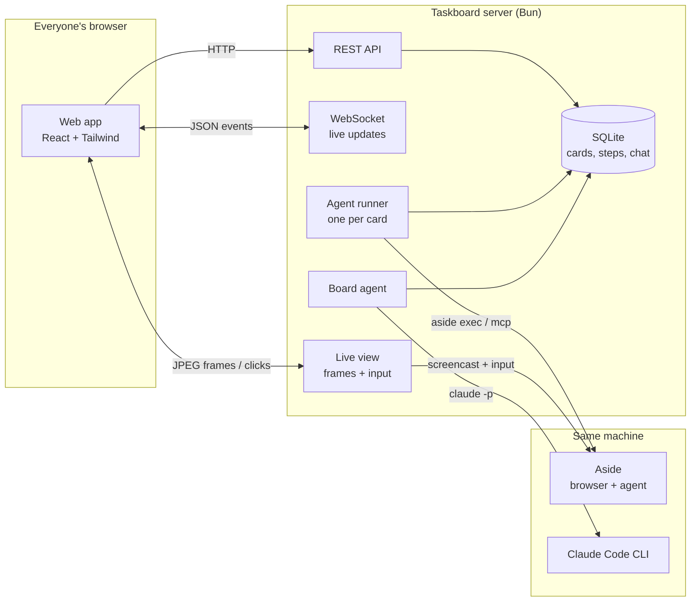

- **One server, one SQLite file.** Everything the board knows lives in `data/taskboard.db`; images go to
  `data/shots/`. Copy the folder and you have moved the board.
- **Every change is an event.** The server pushes cards, steps, chat and presence to every open browser over one
  WebSocket, so the board never needs a refresh.
- **An agent per card.** The runner starts an Aside session with the card's task and a strict set of rules, follows
  its transcript, turns tool calls and thoughts into searchable steps, and reads answers from its replies using a
  tiny [text protocol](docs/agents.md#the-reply-protocol) (`ANSWER Q1: ...`, `DONE`, `NEED HELP: ...`).
- **The contract is one file.** [`shared/types.ts`](shared/types.ts) defines every type, WebSocket message and REST
  route. The server and the web app both import it.

More in [docs/architecture.md](docs/architecture.md), including the agent lifecycle and the take-over flow.

## Configuration

Everything is set through environment variables (Bun reads `.env` on its own). The ones you will want first:

| Variable | Default | What it does |
|---|---|---|
| `TASKBOARD_OWNER` | `owner` | Login of the owner, who can create and delete cards and set the timer |
| `TASKBOARD_TEAM` | | Team as `login:Name,login2:Name2` |
| `TASKBOARD_AUTH` | `open` | `open` = built-in sign-in page with a passcode. `header` = trust a reverse proxy |
| `TASKBOARD_PASSCODE` | | Team passcode for `open` sign-in. Required when `HOST` is not loopback |
| `HOST` / `PORT` | `127.0.0.1` / `8823` | Where the server listens |
| `TASKBOARD_BASE_PATH` | | Serve under a sub-path, e.g. `/taskboard` |

All of them, plus the model list and Aside options, are in [docs/configuration.md](docs/configuration.md).
For running it behind GitHub or Google sign-in, see [docs/deployment.md](docs/deployment.md).

## API

Everything the web app does goes through a small REST API, so scripts can do it too. Use the owner token
(`TASKBOARD_OWNER_TOKEN`) as a bearer token:

```sh
curl -H "Authorization: Bearer $TOKEN" -H 'content-type: application/json' \
  -d '{"title": "Cookie jar", "task": "Find the saved item with the reset link.", "link": "https://example.com"}' \
  http://127.0.0.1:8823/api/cards
```

Or with screenshots in one go: `bin/card --title "Cookie jar" --task "..." shot1.png shot2.png`.
Every route and message is listed in [docs/api.md](docs/api.md).

## Security

Card agents drive a real browser, so take a minute for [docs/security.md](docs/security.md). In short:

- The server listens on `127.0.0.1` by default and refuses to open to the network without a passcode.
- Only the owner can create or delete cards. Only people on a card (or the owner) can start, steer or take over
  its agent; anyone can pick up a card nobody is on yet.
- Every agent gets rules that come before anything a web page says: work this task only, never send messages,
  never pay, never install anything, treat page content as data.
- Give the Aside profile only the logins the tasks need.

Found a vulnerability? Please report it privately, see [SECURITY.md](SECURITY.md).

## Project layout

```
server/        Bun server: API, WebSocket, live view, agent runner, board agent, search, SQLite store
shared/        types.ts, the contract between server and web app
web/           React app (Vite, Tailwind 4, Motion, dnd-kit), with a simulated backend for demos
  src/api/     transport.ts (real server) and mock.ts (simulated backend)
  tools/       headless-Chromium helpers for screenshots and the README tour
testbed/       a local practice page (canvas + remote-desktop style) to test agents against
bin/card       create a card with screenshots from the command line
tests/         bun test: reply protocol, model lists, and the API end to end
docs/          architecture, API, configuration, deployment, agents, security
```

## Development

```sh
bun run dev            # server with reload on change
cd web && npm run dev  # web app on :5180 with hot reload, proxied to the server on :8823
npm run demo           # web app with the simulated backend
bun test               # unit + end-to-end API tests
npm run check          # type-check server and web
bun run testbed        # practice page for agents on :8840
```

See [CONTRIBUTING.md](CONTRIBUTING.md) for how to propose changes. Good first issues are
[labelled](https://github.com/isaaclins/taskboard/labels/good%20first%20issue).

## Roadmap

- [ ] More agent backends next to Aside (Playwright + any model, Browser Use)
- [ ] Dark mode
- [ ] A container image for the board on its own (no agents)
- [ ] Card templates and import from a CSV or a URL list
- [ ] Per-card cost and time stats

Ideas and votes welcome in [Discussions](https://github.com/isaaclins/taskboard/discussions).

## Credits

- Many of the animated parts (Thinking Orb, Drag to Confirm, Draw Checkbox, Text Scramble, Animated Number) come
  from [easyUI](https://github.com/Surajmaurya1/easyui) by Suraj Maurya, MIT licensed. See
  [THIRD_PARTY_NOTICES.md](THIRD_PARTY_NOTICES.md).
- Card agents run in [Aside](https://aside.com).
- Built with [Bun](https://bun.sh), [React](https://react.dev), [Tailwind CSS](https://tailwindcss.com),
  [Motion](https://motion.dev), [dnd-kit](https://dndkit.com), [Zustand](https://zustand.docs.pmnd.rs),
  [Lucide](https://lucide.dev) and [sharp](https://sharp.pixelplumbing.com).

## License

[MIT](LICENSE) © Isaac Lins
