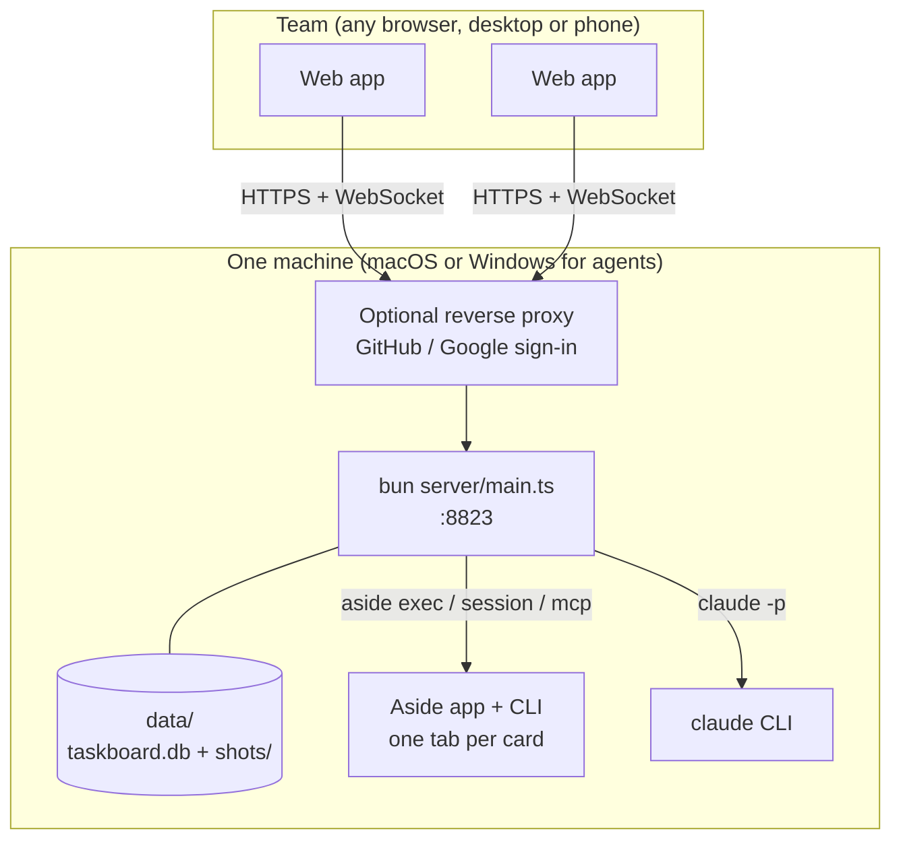
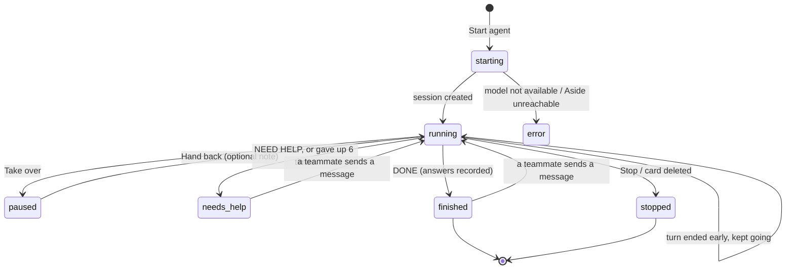
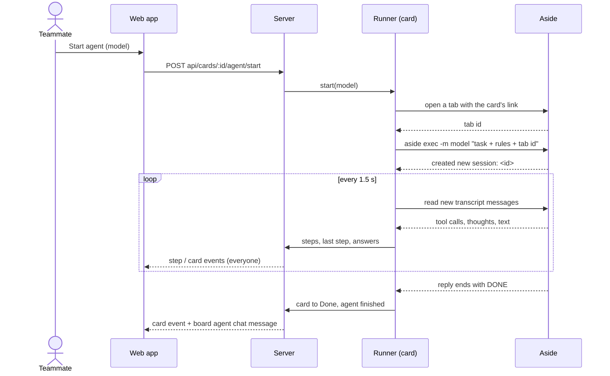
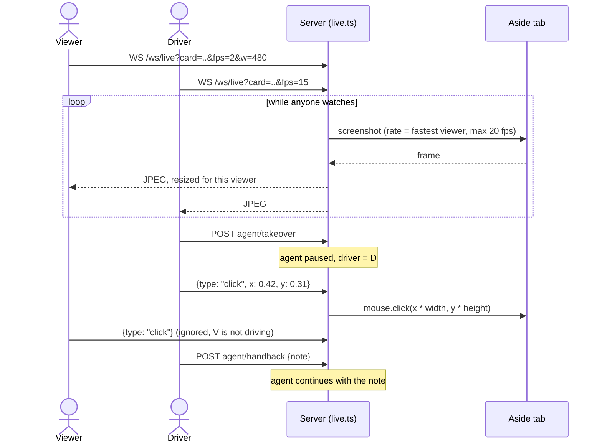

# Architecture

Taskboard is one Bun process, one SQLite file and a React app. Card agents run in [Aside](https://aside.com) on the
same machine; the board agent and the screenshot reader run on the Claude Code CLI.

## Deployment

## Server modules

| File | What it does |
|---|---|
| `server/main.ts` | HTTP routes, sign-in, WebSocket fan-out, static files |
| `server/store.ts` | In-memory state written through to SQLite: cards, steps, chat, team, round |
| `server/agents.ts` | One `Runner` per card: starts the Aside session, follows its transcript, keeps it going |
| `server/protocol.ts` | Parses `ANSWER`, `DONE` and `NEED HELP` lines out of agent replies |
| `server/aside.ts` | Thin wrapper around the Aside CLI and its MCP REPL (tabs, transcripts, frames) |
| `server/live.ts` | Streams a card's tab as JPEG frames to viewers and passes the driver's input back |
| `server/board-agent.ts` | The chat voice: announces answers, nudges, answers `@board` with Claude (no tools) |
| `server/reader.ts` | Reads card screenshots with Claude (Read tool only, limited to the shots folder) |
| `server/search.ts` | Search over every field of every card, the chat and every agent step |
| `server/providers.ts` | The model list (built in, from a file, or from a command) |
| `server/config.ts` | Every setting, from the environment |

The web app lives in `web/src`. `api/transport.ts` talks to the server; `api/mock.ts` implements the same contract
in memory for the demo. State is one Zustand store (`state/store.ts`) fed by WebSocket events.

## Live updates

Every change in `store.ts` emits one event. `main.ts` sends it to every open WebSocket. On connect, a browser gets a
full `snapshot` first, then only events (`card`, `card_deleted`, `step`, `chat`, `presence`, `round`, `models`,
`typing`). The full list is in [`shared/types.ts`](../shared/types.ts).

## Agent lifecycle

## Starting an agent

## Live view and take over

## Keeping agents going

Browser agents sometimes end a turn without finishing. The runner treats that as a pause, not an end:

- A turn that ends without `DONE` or `NEED HELP` gets an automatic "keep going" message, up to 6 times, before a
  person is asked.
- A turn that ends on answer lines without `DONE` is nudged once; the second time it counts as done.
- No new step for 4 minutes means the session hangs: it is stopped and handled like an ended turn.
- After a server restart, running sessions are picked up again from where the transcript was read.
- If Aside closed the card's tab in the meantime, a fresh one is opened before the agent continues.

## Data

`data/taskboard.db` (WAL mode) has four tables: `cards` (one JSON document per card), `steps` (append-only, with an
`extra` column for searchable text that is not shown, like page text a tool call returned), `chat` and `kv` (team,
round). Images are PNG files in `data/shots/`, swept when no card or message uses them any more.
